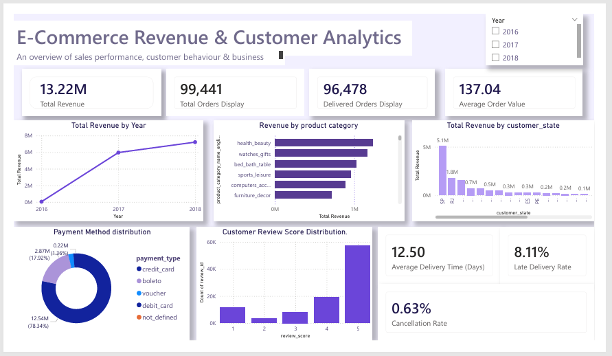
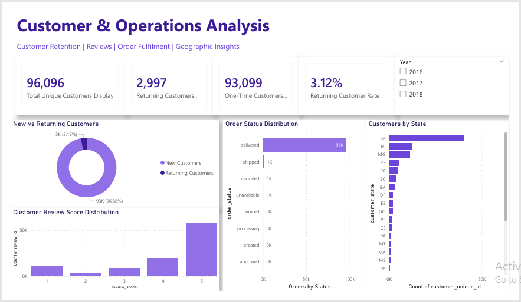

# E-Commerce Revenue & Customer Analytics

## Project Overview
This project analyzes e-commerce transactions to identify revenue trends, customer purchasing behavior, product performance, customer satisfaction, and geographic opportunities using the Brazilian E-Commerce Public Dataset by Olist.

## Objectives
- Analyze revenue, order volume, and average order value (AOV).
- Identify high-performing product categories and products.
- Analyze new and returning customers and customer value.
- Segment customers using RFM analysis.
- Evaluate delivery performance, cancellations, reviews, and payment methods.
- Compare revenue and customer distribution across Brazilian states.

## Tools & Technologies
- Python
- Pandas and NumPy
- Matplotlib
- Jupyter Notebook
- SQL and Power BI for analytics and visualization

## Key Findings
- **Total unique customers:** 96,096
- **Total orders:** 99,441
- **Delivered orders:** 96,478
- **Delivered product revenue:** 13,221,498.11
- **Average order value:** 137.04
- **Average review score:** 4.09/5
- **Top revenue state:** São Paulo (SP)
- **Highest revenue per customer:** Paraíba (PB)

*Note: Monetary values are expressed in the dataset's currency (Brazilian reais, BRL). Revenue is based on product prices and excludes freight.*


## Power BI Dashboard

### Sales Overview


### Customer & Operations Analysis


The interactive Power BI dashboard provides insights into:
- Revenue and order trends
- Product category performance
- Customer purchasing behaviour
- Payment preferences
- Delivery performance
- Customer reviews and satisfaction


## SQL Analysis

Performed SQL-based analysis using PostgreSQL to answer key business questions:

1. Order status distribution
2. Revenue and average order value analysis
3. Revenue by product category
4. New and returning customer analysis
5. Monthly revenue trends
6. Delivery performance analysis
7. Customer review analysis
8. State-wise revenue analysis
9. Payment method analysis
10. Seller performance analysis

SQL concepts used:
- JOINs
- GROUP BY and ORDER BY
- Aggregate functions
- Common Table Expressions (CTEs)
- Window functions
- FILTER clauses
- Date and time functions

## Python Analysis
Used Python for data cleaning, exploratory data analysis (EDA), and customer analytics.

Key activities:
- Loaded and explored the Olist e-commerce datasets using Pandas.
- Cleaned and prepared data for analysis.
- Analyzed sales, customer, product, and order trends.
- Performed customer segmentation using RFM (Recency, Frequency, Monetary) analysis.
- Used Matplotlib to visualize key business patterns.

## Dataset
**Source:** Brazilian E-Commerce Public Dataset by Olist (Kaggle)

The dataset contains approximately 100,000 orders from a Brazilian e-commerce marketplace between 2016 and 2018.

It includes nine interconnected CSV files covering:
- Customers and geographic locations
- Orders and order items
- Products and product categories
- Sellers
- Payments
- Customer reviews

## Project Structure

```text
E-Commerce-Revenue-Customer-Analytics/
│
├── data/
│   └── raw/
│       └── Olist dataset/
│
├── python/
│   └── ecommerce_eda.ipynb
│
├── sql/
│   └── ecommerce_analysis.sql
│
├── powerbi/
│   ├── ecommerce_analytics_dashboard.pbix
│   └── ecommerce_analytics_dashboard.pdf
│
├── screenshots/
│   ├── Sales-Overview.png
│   └── Customer-Operations.png
│
├── kpi_summary.csv
├── business_insights.txt
├── state_revenue_customer_analysis.csv
└── README.md
```

## Business Recommendations
- Maintain the strong revenue base in São Paulo.
- Investigate purchasing patterns in states with higher revenue per customer.
- Use RFM segments to tailor retention and re-engagement campaigns.
- Monitor customer reviews and delivery performance to identify service improvements.


## Installation and Setup

### 1. Clone the repository

```bash
git clone https://github.com/your-username/E-Commerce-Revenue-Customer-Analytics.git
cd E-Commerce-Revenue-Customer-Analytics
```

### 2. Install Python dependencies

```bash
pip install pandas numpy matplotlib jupyter
```

### 3. Run the Python notebook

Open the following notebook in Jupyter Notebook or VS Code:

`python/ecommerce_eda.ipynb`

### 4. Run SQL analysis

- Create a PostgreSQL database.
- Import the Olist CSV files into the database.
- Open `sql/ecommerce_analysis.sql` in pgAdmin.
- Execute the queries.

### 5. Open the Power BI dashboard

Open `powerbi/ecommerce_analytics_dashboard.pbix` using Power BI Desktop.


## Conclusion

This project demonstrates an end-to-end e-commerce analytics workflow using Python, PostgreSQL, and Power BI. It transforms raw transactional data into meaningful business insights through data cleaning, exploratory analysis, SQL querying, customer segmentation, and interactive dashboard development.

The analysis highlights revenue trends, customer purchasing behaviour, product performance, and operational patterns to support data-driven business decisions.

## Disclaimer
The analysis describes historical data and observed patterns. Revenue per customer is not profit, and observed customer revenue is not a predictive lifetime value estimate.
